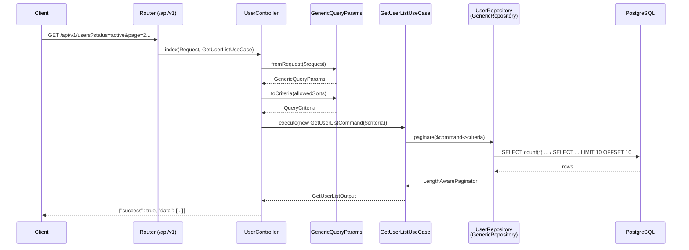

# Tay Trong Ban Tay — Backend

API backend viết bằng Laravel, chia theo **module** (mỗi nghiệp vụ là một module độc lập) và tổ chức code theo 4 tầng `Domain / Application / Inbound / Infrastructure`.

- [Tech stack](#tech-stack)
- [Chạy dự án bằng Docker](#chạy-dự-án-bằng-docker)
- [Cấu hình `.env`](#cấu-hình-env)
- [Cấu trúc dự án](#cấu-trúc-dự-án)
- [Luồng xử lý một request](#luồng-xử-lý-một-request)
- [Viết một tính năng mới](#viết-một-tính-năng-mới)
- [Lệnh thường dùng](#lệnh-thường-dùng)
- [Xử lý lỗi thường gặp](#xử-lý-lỗi-thường-gặp)

## Tech stack

| Thành phần | Phiên bản |
|---|---|
| PHP (trong container) | 8.5 |
| Laravel | 13 |
| Module | [nwidart/laravel-modules](https://laravelmodules.com) 13 |
| Database | PostgreSQL 18 |
| Cache / Session / Queue | Redis |
| Mail (local) | Mailpit |

Môi trường Docker dựa trên Laravel Sail. File liên quan:

- `docker-compose.yaml`: các service `app`, `pgsql`, `redis`, `mailpit`
- `docker/8.5/`: Dockerfile, `php.ini`, `supervisord.conf` của container `app`
- `docker/pgsql/create-testing-database.sql`: tự tạo database `testing` cho PHPUnit

Volume được mount với cờ `:z` để chạy được trên máy bật SELinux (Fedora, RHEL...).

## Chạy dự án bằng Docker

Yêu cầu: Docker và Docker Compose v2. **Máy không cần cài PHP hay Composer.**

### Lần đầu

```bash
# 1. Tạo file env
cp .env.example .env

# 2. Cho container chạy bằng đúng user của máy (tránh file bị owner root)
sed -i "s/^WWWUSER=.*/WWWUSER=$(id -u)/; s/^WWWGROUP=.*/WWWGROUP=$(id -g)/" .env

# 3. Build image và chạy toàn bộ service
docker compose up -d --build

# 4. Cài thư viện PHP, tạo APP_KEY, chạy migration
docker compose exec -u sail app composer install
docker compose exec -u sail app php artisan key:generate
docker compose exec -u sail app php artisan migrate
```

Kiểm tra: mở `http://localhost:8000/up` (đổi `8000` theo `APP_PORT`), thấy trang xanh là chạy được.

> Luôn thêm `-u sail` khi `exec`. Nếu không, lệnh chạy bằng root và file sinh ra (vendor, migration, log...) sẽ thuộc root trên máy bạn.

### Những lần sau

```bash
docker compose up -d      # bật
docker compose down       # tắt (giữ nguyên dữ liệu DB)
docker compose down -v    # tắt và XOÁ dữ liệu DB, Redis
```

Chỉ cần `--build` lại khi sửa file trong `docker/8.5/` hoặc đổi `WWWGROUP`.

### Gõ lệnh cho ngắn

Sau khi đã `composer install`, có thể dùng Sail thay cho `docker compose exec -u sail app ...`:

```bash
alias sail='sh $([ -f sail ] && echo sail || echo vendor/bin/sail)'

sail up -d
sail artisan migrate
sail composer require ...
sail test
sail psql          # vào PostgreSQL
sail redis         # vào redis-cli
sail shell         # vào bash trong container
```

Thêm dòng `alias` vào `~/.bashrc` hoặc `~/.zshrc` để dùng lâu dài.

### Các địa chỉ local

| Service | Địa chỉ (giá trị mặc định) | Biến đổi port |
|---|---|---|
| API | `http://localhost:8000` | `APP_PORT` |
| PostgreSQL (DBeaver, TablePlus...) | `localhost:5432` | `FORWARD_DB_PORT` |
| Redis | `localhost:6379` | `FORWARD_REDIS_PORT` |
| Mailpit (xem mail gửi đi) | `http://localhost:8025` | `FORWARD_MAILPIT_DASHBOARD_PORT` |

## Cấu hình `.env`

`.env.example` đã được chỉnh sẵn để chạy với Docker. Bình thường chỉ cần quan tâm các nhóm sau.

### 1. User và port của Docker

```dotenv
WWWUSER=1000          # = $(id -u)
WWWGROUP=1000         # = $(id -g)

APP_PORT=8000         # port API trên máy
FORWARD_DB_PORT=      # để trống = 5432
FORWARD_REDIS_PORT=   # để trống = 6379
VITE_PORT=            # để trống = 5173
```

Bị trùng port với dịch vụ khác trên máy (Postgres cài sẵn, project khác...) thì đổi các biến này sang port khác. Các biến này **chỉ đổi port phía máy**; bên trong mạng Docker, các service vẫn nói chuyện với nhau qua port gốc.

### 2. URL ứng dụng

```dotenv
APP_URL=http://localhost:${APP_PORT}
```

Laravel hỗ trợ tham chiếu biến trong `.env`, nên đổi `APP_PORT` là `APP_URL` tự đổi theo.

### 3. Database và Redis

```dotenv
DB_CONNECTION=pgsql
DB_HOST=pgsql           # tên service trong docker-compose, KHÔNG phải localhost
DB_PORT=5432            # port bên trong mạng Docker, không phải FORWARD_DB_PORT
DB_DATABASE=taytrongbantay
DB_USERNAME=taytrongbantay
DB_PASSWORD=secret

REDIS_HOST=redis
REDIS_PORT=6379
```

- Container Postgres tạo database, user và password **theo các biến này ở lần chạy đầu tiên**. Đổi `DB_*` sau khi volume đã tạo sẽ không có tác dụng, phải `docker compose down -v` rồi `up` lại (mất dữ liệu).
- `DB_PASSWORD` không được để trống. Compose sẽ cho Postgres dùng `secret`, còn Laravel lại kết nối bằng mật khẩu rỗng nên báo `password authentication failed`.

Muốn chạy `php artisan` **trực tiếp trên máy** (không qua container) thì đổi host về máy và dùng port đã forward:

```dotenv
DB_HOST=127.0.0.1
DB_PORT=5432          # = FORWARD_DB_PORT
REDIS_HOST=127.0.0.1
REDIS_PORT=6379       # = FORWARD_REDIS_PORT
MAIL_HOST=127.0.0.1
```

### 4. Mail

Mặc định mọi mail gửi đi đều được Mailpit giữ lại, xem tại `http://localhost:8025`. Không cần cấu hình thêm.

### 5. Xdebug

Mặc định tắt. Muốn debug thì thêm vào `.env` rồi `docker compose up -d` lại:

```dotenv
SAIL_XDEBUG_MODE=develop,debug
```

IDE lắng nghe port `9003`. Nếu dùng VS Code, map path `/var/www/html` → thư mục project.

### 6. Môi trường test

`phpunit.xml` tự ghi đè: `DB_DATABASE=testing`, cache/session dạng `array`, queue `sync`, mail `array`. Database `testing` được tạo tự động khi Postgres khởi tạo lần đầu, nên không cần làm gì thêm.

## Cấu trúc dự án

```
app/
├── Core/          Nền tảng gắn với Laravel: HTTP, Eloquent, provider
├── Shared/        Khối dùng chung cho tầng Application của mọi module
└── Modules/       Mỗi nghiệp vụ một module (sinh bằng php artisan module:make)
config/modules.php     Quy định cấu trúc thư mục khi sinh module/class
stubs/nwidart-stubs/   Template code khi chạy module:make-*
```

### `app/Core`

| Thư mục | Nội dung |
|---|---|
| `Http/Controllers` | `Controller`, `ApiController` (controller của module extend class này) |
| `Traits/ApiBehavior` | `success()` / `error()`: format response JSON chuẩn |
| `Models/BaseModel` | Model của module extend class này |
| `Repositories` | `BaseRepositoryInterface`, `GenericRepository`: CRUD, phân trang, autocomplete... |
| `Support/Criteria/QueryCriteria` | Điều kiện truy vấn (where, sort, with, phân trang) truyền vào repository |
| `DTOs` | `BaseQueryParams`, `GenericQueryParams`: đọc query string → `QueryCriteria` |
| `Providers` | `AppServiceProvider` |

### `app/Shared`

| Thư mục | Nội dung |
|---|---|
| `UseCases/UseCase` | Interface đánh dấu cho mọi use case |
| `Commands` | `BaseCommand`, `VoidCommand`, `QueryCommand` (cho use case dạng đọc): input của use case |
| `Outputs` | `BaseOutput`, `VoidOutput`, `PaginationOutput`: output của use case |
| `Security/PasswordHasher` | Hash và kiểm tra mật khẩu |

### `app/Modules/<Module>`

```
<Module>/
├── Domain/                          Model Eloquent, enum, observer
├── Application/
│   ├── Command/                     Input của use case (readonly class)
│   ├── Output/                      Output của use case (readonly class)
│   ├── UseCase/                     Business logic, mỗi class một hành động
│   └── Port/Out/                    Interface cho dịch vụ ngoài (chỉ tạo khi cần)
├── Inbound/
│   └── Rest/V1/
│       ├── Controllers/
│       ├── Dtos/                    FormRequest, API Resource
│       └── Routes/api.php           Route của module, tự có prefix /api/v1
├── Infrastructure/
│   ├── Persistence/                 Repository (extends GenericRepository)
│   │   └── Migrations/              Migration của module, tự được nạp khi migrate
│   ├── Seeders/
│   └── Providers/                   ServiceProvider, RouteServiceProvider
├── Config/config.php                Đọc bằng config('<module>.key')
└── Tests/{Feature,Unit}
```

Luồng một request (chi tiết ở phần [Luồng xử lý một request](#luồng-xử-lý-một-request)):

```
Ghi:  Request ─► FormRequest::toCommand() ─────────────────────────► Command ─► UseCase ─► Repository ─► Model
Đọc:  Request ─► QueryParams ─► QueryCriteria ─► new XxxCommand($criteria) ─► UseCase ─► Repository ─► Model
                                                                                  │
Response ◄── ApiController::success() ◄────────────────────────── Output ◄───────┘
```

Quy ước:

- **Controller** chỉ làm 3 việc: nhận request đã validate, gọi use case, trả response. Không viết business logic, không query Eloquent.
- **Mọi hành động, cả đọc lẫn ghi, đều đi qua UseCase.** Controller không gọi thẳng repository.
- **UseCase** chứa business logic. Nhận `Command`, trả `Output`, không đụng tới `Request`/`Response`.
- **Repository** là nơi duy nhất query database.
- Chỉ tạo interface ở `Application/Port/Out` khi thật sự có khả năng đổi implementation (gọi API ngoài, payment gateway, storage...). CRUD bình thường thì use case inject thẳng repository.
- Module không gọi thẳng repository của module khác. Cần dữ liệu thì gọi use case của module đó.

## Luồng xử lý một request

Phần này đi lần lượt từng bước, từ lúc request vào tới lúc repository chạy SQL rồi trả JSON về. Có hai ví dụ, cả hai giả sử module `Identity` có model `User`:

- **Đọc:** `GET /api/v1/users?status=active&orderBy=name&orderDirection=asc&page=2&perPage=10`
- **Ghi:** `POST /api/v1/users` với body `{"name": "An", "email": "an@example.com", "password": "12345678"}`

### Tổng quan các class tham gia

| # | Class | File | Trách nhiệm |
|---|---|---|---|
| 1 | `IdentityServiceProvider` | `Infrastructure/Providers/` | Đăng ký module: nạp config, migration, route provider |
| 2 | `RouteServiceProvider` | `Infrastructure/Providers/` | Gắn file route của module vào prefix `/api` |
| 3 | Route file | `Inbound/Rest/V1/Routes/api.php` | Thêm prefix `/v1`, map URL → method controller |
| 4 | `UserController` | `Inbound/Rest/V1/Controllers/` | Nhận request, tạo Command, gọi UseCase, trả JSON |
| 5a | `CreateUserRequest` (ghi) | `Inbound/Rest/V1/Dtos/` | Validate body, đổi thành Command |
| 5b | `GenericQueryParams` (đọc) | `app/Core/DTOs/` | Đọc query string, đổi thành `QueryCriteria` |
| 6 | `QueryCriteria` | `app/Core/Support/Criteria/` | Gói điều kiện where, sort, phân trang |
| 7 | `CreateUserCommand` / `GetUserListCommand` | `Application/Command/` | Input của use case |
| 8 | `CreateUserUseCase` / `GetUserListUseCase` | `Application/UseCase/` | Business logic |
| 9 | `UserRepository` → `GenericRepository` | `Infrastructure/Persistence/`, `app/Core/Repositories/` | Chạy SQL qua Eloquent |
| 10 | `User` → `BaseModel` | `Domain/`, `app/Core/Models/` | Map bảng `users` |
| 11 | `CreateUserOutput` / `GetUserListOutput` | `Application/Output/` | Output của use case |
| 12 | `UserResource` | `Inbound/Rest/V1/Dtos/` | Chọn field nào được trả ra JSON |
| 13 | `ApiController::success()` | `app/Core/Http/Controllers/`, `app/Core/Traits/ApiBehavior` | Bọc data vào format JSON chuẩn |



### Bước 0. Lúc ứng dụng khởi động: route của module được nạp thế nào

Trước khi có request nào, Laravel đã nạp sẵn route của mọi module:

1. Package `nwidart/laravel-modules` đọc `modules_statuses.json` để biết module nào đang bật, rồi đọc `app/Modules/<Module>/module.json` của từng module.
2. `module.json` khai báo provider chính, ví dụ `IdentityServiceProvider`. Class này extend `ModuleServiceProvider` của nwidart, nên tự động:
   - nạp `Config/config.php` vào key `identity` (đọc bằng `config('identity.xxx')`);
   - đăng ký thư mục `Infrastructure/Persistence/Migrations` để `php artisan migrate` thấy migration của module;
   - đăng ký các provider con trong `$providers`, ở đây là `RouteServiceProvider`.
3. `RouteServiceProvider::mapApiRoutes()` nạp file route của module:

   ```php
   Route::middleware('api')->prefix('api')->name('api.')
       ->group(module_path($this->name, '/Inbound/Rest/V1/Routes/api.php'));
   ```

4. Trong file route, module tự thêm `v1`:

   ```php
   Route::prefix('v1')->name('identity.')->group(function () {
       Route::get('users', [UserController::class, 'index'])->name('users.index');
   });
   ```

   Kết quả: URL `/api/v1/users`, tên route `api.identity.users.index`.

Tắt module (`php artisan module:disable Identity`) thì toàn bộ bước trên bị bỏ qua, route của module biến mất.

### Flow đọc: `GET /api/v1/users?...`

#### Bước 1. Router gọi controller, container tự tạo dependency

Router khớp URL với `UserController@index`. Method có hai tham số:

```php
public function index(Request $request, GetUserListUseCase $useCase): JsonResponse
```

Laravel tự tạo hai object này (dependency injection). Để tạo `GetUserListUseCase`, container đọc constructor của nó và tạo tiếp dây chuyền phía sau:

```
GetUserListUseCase(UserRepository $users)
    └── UserRepository(User $model)
            └── User  (một instance model rỗng, chỉ dùng để tạo query)
```

Vì vậy không cần đăng ký gì trong ServiceProvider: class cụ thể nào cũng tự được inject.

#### Bước 2. `GenericQueryParams::fromRequest()`: query string → object có kiểu

```php
$params = GenericQueryParams::fromRequest($request);
```

`BaseQueryParams::fromRequest()` lấy `$request->query()` (**chỉ query string, không đọc body**), rồi duyệt từng property `public` của class và ép kiểu theo kiểu đã khai báo:

| Query string | Property | Kiểu khai báo | Giá trị sau khi ép |
|---|---|---|---|
| `page=2` | `$page` | `?int` | `2` |
| `perPage=10` | `$perPage` | `int` | `10` |
| `orderBy=name` | `$orderBy` | `?string` | `'name'` |
| `orderDirection=asc` | `$orderDirection` | `string` | `'asc'` |
| `status=active` | `$status` | `?string` | `'active'` |
| *(không truyền)* | `$with` | `array` | `[]` (giữ mặc định) |

Quy tắc ép kiểu (`castValue()`):

- `int`, `float`: chỉ nhận nếu là số, không thì thành `null`.
- `bool`: `"true"`, `"1"`, `"on"` → `true`; `"false"`, `"0"`, `"off"` → `false`.
- `array`: chuỗi `"a,b,c"` được tách theo dấu phẩy thành `['a', 'b', 'c']`.
- Kiểu là `BackedEnum`: gọi `Enum::tryFrom($value)`, sai giá trị thì thành `null`.
- Giá trị rỗng (`""`) hoặc không có trong query string: bỏ qua, property giữ giá trị mặc định.

Màn hình nào cần filter riêng thì tạo class extend `BaseQueryParams` và khai báo thêm property public. `fromRequest()` tự đọc các property đó, không phải viết code parse.

#### Bước 3. `toCriteria()`: object → `QueryCriteria`

```php
$criteria = $params->toCriteria(allowedSorts: ['name', 'created_at']);
```

`toCriteria()` dựng một `QueryCriteria` theo thứ tự:

```php
$criteria = QueryCriteria::make()
    ->paginate(2, 10)                    // vì có page; không có page thì chỉ ->perPage(10)
    ->orderBy('name', 'asc', ['name', 'created_at'])
    ->where(['status' => 'active']);     // từ applyCustomCriteria()
```

Từng điểm cần biết:

- **Giới hạn phân trang:** `page` nhỏ nhất là 1, `perPage` bị kẹp trong khoảng 1–100. Client gửi `perPage=10000` thì vẫn chỉ lấy 100.
- **Whitelist cột sort:** `orderBy` chỉ được áp dụng nếu cột nằm trong `allowedSorts`. Client gửi `orderBy=password` thì **bị bỏ qua lặng lẽ**, không báo lỗi. Truyền `allowedSorts` rỗng nghĩa là cho sort mọi cột, nên luôn truyền danh sách.
- **Chiều sort:** chỉ `asc` được giữ, mọi giá trị khác đều thành `desc`.
- **Filter:** `applyCustomCriteria()` là hook để class con quyết định property nào thành điều kiện `where`. `GenericQueryParams` chỉ map `status` → `where status = ?` và `ids` → `where id in (...)`.
- **Bất biến (immutable):** mọi method của `QueryCriteria` (`where`, `orderBy`, `paginate`...) đều trả về **bản sao mới**, không sửa object cũ. Nhờ vậy có thể tạo một criteria gốc rồi dùng lại nhiều nơi mà không sợ bị ảnh hưởng chéo:

  ```php
  $base   = QueryCriteria::make()->where('status', 'active');
  $admins = $base->where('role', 'admin');   // $base vẫn chỉ có status = active
  ```

Cách viết điều kiện với `where()`:

```php
->where('status', 'active')                  // status = 'active'
->where('age', '>=', 18)                     // age >= 18
->where('name', 'like', 'An%')               // name like 'An%'
->whereIn('id', [1, 2, 3])                   // id in (1, 2, 3)
->whereBetween('created_at', [$from, $to])
->whereNull('deleted_at')
->where(['status' => 'active', 'age' => ['>=', 18]])   // nhiều điều kiện cùng lúc
->with(['roles'])                            // eager load quan hệ
->select(['id', 'name'])                     // chỉ lấy vài cột
```

#### Bước 4. Bọc vào Command và gọi use case

```php
$output = $useCase->execute(new GetUserListCommand($criteria));
```

`GetUserListCommand extends QueryCommand`, bên trong chỉ có `public QueryCriteria $criteria`. Use case không biết gì về HTTP: nó chỉ nhận một Command. Nhờ vậy cùng use case đó có thể gọi từ console command, queue job, test hay module khác mà không cần giả lập `Request`.

#### Bước 5. Use case gọi repository

```php
public function execute(GetUserListCommand $command): GetUserListOutput
{
    return new GetUserListOutput($this->users->paginate($command->criteria));
}
```

Use case danh sách đơn giản chỉ có một dòng. Logic như kiểm tra quyền, thêm điều kiện bắt buộc (`where('tenant_id', ...)`) hay ghép dữ liệu từ module khác đều nằm ở đây.

#### Bước 6. Repository dựng câu SQL

`UserRepository` không tự viết `paginate()`, nó dùng của `GenericRepository`:

```php
public function paginate(?QueryCriteria $criteria = null): LengthAwarePaginator
{
    $criteria ??= QueryCriteria::make();

    return $this->query($criteria)->paginate(
        perPage: $criteria->getPerPage(),
        columns: $criteria->getColumns(),
        page: $criteria->getPage(),
    );
}

public function query(?QueryCriteria $criteria = null): Builder
{
    $query = $this->model->newQuery();          // User::query()

    if ($criteria !== null) {
        $query = $criteria->applyTo($query, $this->model);
    }

    return $query;
}
```

`QueryCriteria::applyTo()` dịch các điều kiện đã gom thành lời gọi Eloquent Builder, theo thứ tự:

1. `with` → `$query->with([...])`
2. từng `where` → `where` / `whereIn` / `whereBetween` / `whereNull`... Tên cột được thêm tên bảng (`qualifyColumn`), `status` thành `"users"."status"`, nên không bị lỗi cột trùng tên khi join.
3. từng `orderBy` → `$query->orderBy(...)`
4. `limit` (nếu có)
5. `select` các cột

Cuối cùng Laravel `paginate()` chạy **hai câu SQL**:

```sql
select count(*) as aggregate from "users" where "users"."status" = 'active';

select * from "users" where "users"."status" = 'active'
order by "users"."name" asc limit 10 offset 10;
```

Kết quả là một `LengthAwarePaginator`: danh sách 10 `User` của trang 2, kèm tổng số bản ghi, số trang...

#### Bước 7. Output về controller, controller trả JSON

```php
$output = $useCase->execute(new GetUserListCommand($criteria));

return $this->success(
    $output->paginator->through(fn (User $user) => new UserResource($user))
);
```

- `GetUserListOutput extends PaginationOutput`, chứa `public LengthAwarePaginator $paginator`.
- `through()` đổi từng `User` thành `UserResource`, để chỉ trả ra các field đã chọn (không lộ `password`...) mà vẫn giữ thông tin phân trang.
- `success()` (trait `ApiBehavior`) bọc lại thành format chung:

```json
{
    "success": true,
    "code": 200,
    "message": "success",
    "data": {
        "current_page": 2,
        "data": [ { "id": 11, "name": "An" } ],
        "per_page": 10,
        "total": 47,
        "last_page": 5,
        "from": 11,
        "to": 20,
        "first_page_url": "...", "last_page_url": "...",
        "next_page_url": "...", "prev_page_url": "...",
        "links": [ ... ],
        "path": "..."
    }
}
```

> Không viết `$this->success(UserResource::collection($output->paginator))`. Khi bị bọc trong `success()`, resource collection chỉ còn mảng item, **mất hết thông tin phân trang**. Dùng `through()` như trên.

### Flow ghi: `POST /api/v1/users`

```php
public function store(CreateUserRequest $request, CreateUserUseCase $useCase): JsonResponse
{
    $output = $useCase->execute($request->toCommand());

    return $this->success(new UserResource($output->user), 201);
}
```

#### Bước 1. FormRequest validate **trước khi** vào controller

Khi container tạo `CreateUserRequest`, Laravel tự chạy:

1. `authorize()`: trả `false` thì dừng, trả **403**.
2. `rules()`: dữ liệu sai thì dừng, trả **422**:

   ```json
   {
       "message": "The email field is required.",
       "errors": { "email": ["The email field is required."] }
   }
   ```

Lỗi xảy ra ở đây thì code trong `store()` **không hề chạy**. Vì vậy controller không cần tự kiểm tra dữ liệu.

#### Bước 2. `toCommand()`: dữ liệu đã validate → Command

```php
public function toCommand(): CreateUserCommand
{
    return new CreateUserCommand(...$this->validated());
}
```

- `validated()` chỉ trả các field có trong `rules()`; field lạ client gửi thêm bị loại.
- `...` trải mảng `['name' => ..., 'email' => ..., 'password' => ...]` thành tham số đặt tên, tương đương `new CreateUserCommand(name: ..., email: ..., password: ...)`.
- **Key phải trùng đúng tên tham số constructor.** Input kiểu snake_case (`first_name`) mà property là `$firstName`, hoặc có field validate nhưng Command không cần, thì PHP báo lỗi `Unknown named parameter`. Khi đó map tay:

  ```php
  return new CreateUserCommand(
      firstName: $this->validated('first_name'),
      email: $this->validated('email'),
  );
  ```

- Command là `readonly`: tạo xong không ai sửa được, use case nhận đúng thứ đã validate.

#### Bước 3. Use case xử lý nghiệp vụ

```php
public function execute(CreateUserCommand $command): CreateUserOutput
{
    $user = $this->users->create([
        'name' => $command->name,
        'email' => $command->email,
        'password' => PasswordHasher::hash($command->password),
    ]);

    return new CreateUserOutput($user);
}
```

Đây là chỗ đặt mọi quy tắc nghiệp vụ: hash mật khẩu, kiểm tra điều kiện, ném exception khi vi phạm, gọi use case module khác, bọc `DB::transaction()` khi ghi nhiều bảng.

#### Bước 4. Repository ghi DB

`GenericRepository::create()`:

```php
DB::beginTransaction();
$created = $this->model->newQuery()->create($data);   // INSERT INTO users ...
DB::commit();
```

- Chỉ các key nằm trong `$fillable` của model được ghi (chống mass-assignment).
- Lỗi thì `rollBack()`, ghi log `storage/logs/laravel.log`, rồi ném lại exception cho tầng trên.
- Use case đã bọc `DB::transaction()` bên ngoài thì transaction này thành savepoint lồng bên trong, vẫn an toàn.

Các method ghi khác:

| Method | Hành vi |
|---|---|
| `update($id, $data)` | `findOrFail($id)` (không có thì **404**), `fill` + `save`, trả model đã `refresh()` |
| `delete($id, $force = false)` | Trả `true` nếu xoá được ít nhất 1 dòng. `$force = true` để xoá hẳn khi model dùng `SoftDeletes` |

#### Bước 5. Trả response

Use case trả `CreateUserOutput($user)`. Controller dùng `UserResource` chọn field rồi `success(..., 201)`:

```json
{ "success": true, "code": 201, "message": "success", "data": { "id": 1, "name": "An", "email": "an@example.com" } }
```

### Lỗi đi đâu

Trong `bootstrap/app.php`, mọi request tới `api/*` đều được trả lỗi dạng JSON:

| Tình huống | Ai xử lý | HTTP |
|---|---|---|
| Dữ liệu không hợp lệ | FormRequest | 422 |
| `authorize()` trả `false` | FormRequest | 403 |
| Không tìm thấy bản ghi (`findOrFail`, `firstOrFail`) | Laravel tự bắt `ModelNotFoundException` | 404 |
| Vi phạm nghiệp vụ | Use case ném exception trong `Domain/Exceptions/` | Theo exception |
| Lỗi không lường trước | Laravel | 500 (kèm stack trace khi `APP_DEBUG=true`) |

Lỗi 422/404 do Laravel trả có format `{"message", "errors"}`, khác với format `{"success", "code", "message", "data"}` của `success()`. Frontend cần xử lý cả hai.

### Vì sao chia nhiều lớp như vậy

| Câu hỏi | Trả lời |
|---|---|
| Sao không truyền thẳng `Request` vào use case? | Use case sẽ dính HTTP, không gọi được từ console, queue, test hay module khác. Command là input thuần dữ liệu. |
| Sao cần Output, trả model luôn không được à? | Output là "hợp đồng" của use case. Sau này thêm dữ liệu (ví dụ token, thống kê) chỉ cần thêm property, không phải sửa chữ ký hàm. |
| Sao controller không gọi repository cho nhanh? | Logic sẽ rải rác ở controller. Khi cần thêm quy tắc (phân quyền, lọc theo tenant...) thì phải sửa nhiều chỗ. Đi qua use case thì chỉ sửa một chỗ. |
| Sao query phải qua repository? | Gom mọi câu SQL về một nơi. Dễ tối ưu, dễ thêm index, dễ tìm khi debug. |
| Sao `QueryCriteria` lại bất biến? | Criteria được truyền qua nhiều lớp. Nếu lớp nào đó sửa trực tiếp thì lớp khác bị ảnh hưởng mà không biết. |

### Giới hạn hiện tại của `Core`

Đây là hành vi **đang có** trong code, cần biết để không bất ngờ:

- `GenericQueryParams` có property `search`, `fromDate`, `toDate` nhưng **chưa áp dụng** vào query. Truyền lên không có tác dụng. Cần thì override `applyCustomCriteria()` trong QueryParams riêng.
- `?ids=1,2,3` hiện bị dịch sai thành `id = '2'` thay vì `id in (1, 2, 3)`. Trong code tự viết, dùng `->whereIn('id', [...])` trực tiếp.
- `cursor` được đọc vào `QueryCriteria` nhưng `GenericRepository::paginate()` chưa dùng tới (vẫn phân trang theo `page`).
- `with` lấy thẳng từ query string, chưa có whitelist. Client gửi tên quan hệ không tồn tại sẽ gây lỗi 500.

## Viết một tính năng mới

Ví dụ: API tạo user trong module `Identity`.

### 1. Tạo module (nếu chưa có)

```bash
php artisan module:make Identity --api
```

### 2. Sinh các class

```bash
php artisan module:make-model User Identity                  # Domain/User.php
php artisan module:make-migration create_users_table Identity
php artisan module:make-repository UserRepository Identity   # Infrastructure/Persistence/
php artisan module:make-request CreateUserRequest Identity   # Inbound/Rest/V1/Dtos/
php artisan module:make-service CreateUserUseCase Identity   # Application/UseCase/
php artisan module:make-resource UserResource Identity       # Inbound/Rest/V1/Dtos/
php artisan module:make-controller UserController Identity --api   # Inbound/Rest/V1/Controllers/
```

`Command` và `Output` thì viết tay trong `Application/Command` và `Application/Output`.

> Chạy qua Docker thì thêm tiền tố `docker compose exec -u sail app` hoặc dùng `sail artisan ...`.

### 3. Viết code

```php
// Application/Command/CreateUserCommand.php
final readonly class CreateUserCommand extends BaseCommand
{
    public function __construct(
        public string $name,
        public string $email,
        public string $password,
    ) {}
}

// Application/Output/CreateUserOutput.php
final readonly class CreateUserOutput extends BaseOutput
{
    public function __construct(public User $user) {}
}

// Inbound/Rest/V1/Dtos/UserResource.php — chỉ trả các field này ra JSON
public function toArray(Request $request): array
{
    return [
        'id' => $this->id,
        'name' => $this->name,
        'email' => $this->email,
    ];
}

// Inbound/Rest/V1/Dtos/CreateUserRequest.php
public function toCommand(): CreateUserCommand
{
    return new CreateUserCommand(...$this->validated());
}

// Infrastructure/Persistence/UserRepository.php
final class UserRepository extends GenericRepository
{
    public function __construct(User $model)
    {
        parent::__construct($model);
    }
}

// Application/UseCase/CreateUserUseCase.php
final class CreateUserUseCase implements UseCase
{
    public function __construct(private readonly UserRepository $users) {}

    public function execute(CreateUserCommand $command): CreateUserOutput
    {
        $user = $this->users->create([
            'name' => $command->name,
            'email' => $command->email,
            'password' => PasswordHasher::hash($command->password),
        ]);

        return new CreateUserOutput($user);
    }
}

// Inbound/Rest/V1/Controllers/UserController.php
public function store(CreateUserRequest $request, CreateUserUseCase $useCase): JsonResponse
{
    $output = $useCase->execute($request->toCommand());

    return $this->success(new UserResource($output->user), 201);
}

// Inbound/Rest/V1/Routes/api.php
Route::prefix('v1')->name('identity.')->group(function () {
    Route::post('users', [UserController::class, 'store'])->name('users.store');
});
```

### 4. Use case dạng đọc (danh sách, chi tiết, tìm kiếm)

Flow đọc cũng đi qua `Command` → `UseCase` như flow ghi. Command của flow đọc extend `QueryCommand`, bên trong chứa `QueryCriteria`:

```
Request ─► QueryParams ─► QueryCriteria ─► QueryCommand ─► UseCase ─► Repository
```

```php
// Application/Command/GetUserListCommand.php
final readonly class GetUserListCommand extends QueryCommand {}

// Application/Output/GetUserListOutput.php
final readonly class GetUserListOutput extends PaginationOutput {}

// Application/UseCase/GetUserListUseCase.php
public function execute(GetUserListCommand $command): GetUserListOutput
{
    return new GetUserListOutput($this->users->paginate($command->criteria));
}

// Controller
public function index(Request $request, GetUserListUseCase $useCase): JsonResponse
{
    $criteria = GenericQueryParams::fromRequest($request)
        ->toCriteria(allowedSorts: ['name', 'created_at']);

    $output = $useCase->execute(new GetUserListCommand($criteria));

    return $this->success(
        $output->paginator->through(fn (User $user) => new UserResource($user))
    );
}
```

Cần thêm tham số ngoài điều kiện truy vấn (ví dụ user đang đăng nhập) thì khai báo thêm trong Command:

```php
final readonly class GetMyOrdersCommand extends QueryCommand
{
    public function __construct(QueryCriteria $criteria, public int $userId)
    {
        parent::__construct($criteria);
    }
}
```

## Lệnh thường dùng

Các lệnh dưới đây chạy trong container (`sail ...` hoặc `docker compose exec -u sail app ...`).

```bash
php artisan migrate                    # chạy migration của app và mọi module
php artisan module:migrate Identity    # chỉ migration của 1 module
php artisan migrate:fresh --seed       # xoá sạch DB, migrate và seed lại
php artisan module:list                # liệt kê module, trạng thái bật/tắt
php artisan module:disable Identity    # tắt module (trạng thái lưu trong modules_statuses.json)
php artisan route:list --path=api      # xem route API
php artisan test                       # chạy test
vendor/bin/pint                        # format code
```

Xem log:

```bash
docker compose logs -f app             # log của PHP server
tail -f storage/logs/laravel.log       # log của Laravel
```

## Xử lý lỗi thường gặp

**`password authentication failed for user ...`**
`DB_PASSWORD` trong `.env` khác với mật khẩu Postgres đã khởi tạo, hoặc đang để trống. Sửa `DB_PASSWORD` cho đúng. Nếu muốn khởi tạo lại DB theo `.env` mới thì `docker compose down -v && docker compose up -d` (mất dữ liệu).

**`Bind for 0.0.0.0:8000 failed: port is already allocated`**
Port đang bị dịch vụ khác dùng. Đổi `APP_PORT` (hoặc `FORWARD_DB_PORT`, `FORWARD_REDIS_PORT`) trong `.env`.

**`Permission denied` với `storage/` hoặc `bootstrap/cache/`, hoặc file trong project thuộc root**
`WWWUSER`/`WWWGROUP` chưa khớp với user máy, hoặc đã `exec` mà không có `-u sail`. Sửa `.env` rồi chạy:

```bash
sudo chown -R $(id -u):$(id -g) .
docker compose up -d --build
```

**Container chạy nhưng không đọc được file (Fedora, RHEL)**
Do SELinux. Kiểm tra volume trong `docker-compose.yaml` còn cờ `:z`.

**Sửa `.env` nhưng app không nhận**
Có thể đang dùng config đã cache: `php artisan config:clear`.

**Thêm module mới nhưng route hoặc class không thấy**
Kiểm tra module đã bật (`php artisan module:list`), rồi chạy `composer dump-autoload` và `php artisan optimize:clear`.
