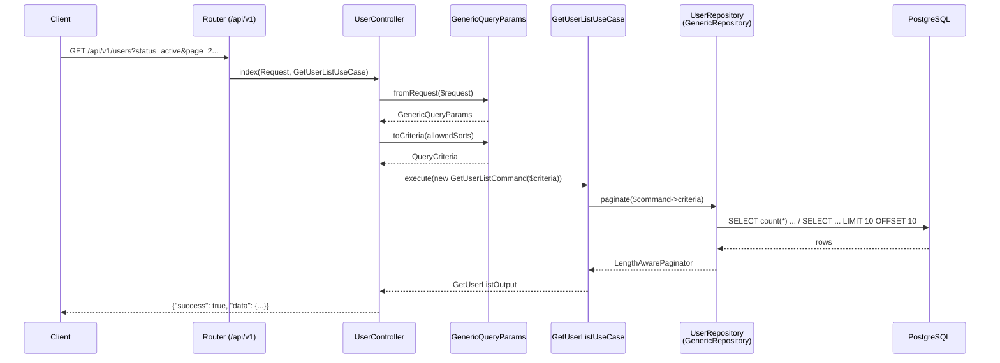

# Tay Trong Ban Tay — Backend

Backend Laravel gồm hai phần:

- **REST API** cho client, dưới `/api/v1/...`, chia theo **module** và tổ chức code theo 4 tầng `Domain / Application / Inbound / Infrastructure`.
- **Trang quản trị Filament** cho nội bộ, dưới `/${ADMIN_PATH}` (mặc định `/admin`), phân quyền bằng Filament Shield.

Mục lục:

- [Tech stack](#tech-stack)
- [Docker Compose hoạt động thế nào](#docker-compose-hoạt-động-thế-nào)
- [Chạy dự án lần đầu](#chạy-dự-án-lần-đầu)
- [Dev dùng Windows](#dev-dùng-windows)
- [Bật, tắt, xem trạng thái](#bật-tắt-xem-trạng-thái)
- [Vào container để chạy lệnh PHP](#vào-container-để-chạy-lệnh-php)
- [Trang quản trị Filament và tài khoản super admin](#trang-quản-trị-filament-và-tài-khoản-super-admin)
- [Cấu hình `.env`](#cấu-hình-env)
- [Cấu trúc dự án](#cấu-trúc-dự-án)
- [Luồng xử lý một request](#luồng-xử-lý-một-request)
- [Viết một tính năng mới](#viết-một-tính-năng-mới)
- [Lệnh thường dùng](#lệnh-thường-dùng)
- [Xử lý lỗi thường gặp](#xử-lý-lỗi-thường-gặp)

## Tech stack

| Thành phần | Phiên bản |
|---|---|
| PHP (trong container) | 8.5 |
| Laravel | 13 |
| Chia module | [nwidart/laravel-modules](https://laravelmodules.com) 13 |
| Trang quản trị | Filament 5 |
| Phân quyền trang quản trị | Filament Shield 4 (dùng `spatie/laravel-permission`) |
| Database | PostgreSQL 18 |
| Cache / Session / Queue | Redis |
| Mail (local) | Mailpit |

## Docker Compose hoạt động thế nào

Môi trường local dựa trên Laravel Sail. `docker-compose.yaml` dựng 4 container trong cùng một mạng nội bộ tên `sail`:

```
Máy của bạn                          Container (mạng nội bộ "sail")
──────────────────────────           ─────────────────────────────────────────
localhost:APP_PORT          ───────► app:80        Laravel (php artisan serve)
localhost:FORWARD_DB_PORT   ───────► pgsql:5432    PostgreSQL
localhost:FORWARD_REDIS_PORT ──────► redis:6379    Redis
localhost:8025              ───────► mailpit:8025  Giao diện Mailpit

Thư mục project ═══ mount ═════════► app:/var/www/html

Bên trong mạng, app gọi các service khác bằng tên:
  app ──► pgsql:5432     (DB_HOST=pgsql)
  app ──► redis:6379     (REDIS_HOST=redis)
  app ──► mailpit:1025   (MAIL_HOST=mailpit)
```

| Service | Image | Vai trò | Port máy → container | Dữ liệu lưu ở |
|---|---|---|---|---|
| `app` | `sail-8.5/app` (build từ `docker/8.5/`) | Chạy Laravel | `APP_PORT` → 80 | Code mount trực tiếp từ thư mục project |
| `pgsql` | `postgres:18-alpine` | Database | `FORWARD_DB_PORT` (mặc định 5432) → 5432 | Volume `sail-pgsql` |
| `redis` | `redis:alpine` | Cache, session, queue | `FORWARD_REDIS_PORT` (mặc định 6379) → 6379 | Volume `sail-redis` |
| `mailpit` | `axllent/mailpit` | Hộp thư giả, giữ lại mọi mail gửi đi | 1025 (SMTP), 8025 (giao diện web) | Không lưu |

Những điểm cần nắm:

- **Container `app`** được build từ `docker/8.5/Dockerfile` (Ubuntu 24.04, PHP 8.5, Composer, Node). Khi khởi động, script `docker/8.5/start-container` đổi UID của user `sail` trong container thành `WWWUSER` của bạn, rồi `supervisord` chạy `php artisan serve --host=0.0.0.0 --port=80`.
- **Code được mount**, không copy vào image (`.:/var/www/html:z`). Sửa code trên máy là container thấy ngay, không cần build lại. Cờ `:z` để chạy được trên máy bật SELinux (Fedora, RHEL...).
- **Các container gọi nhau bằng tên service**: Laravel kết nối DB qua host `pgsql`, Redis qua `redis`, mail qua `mailpit`. Đó là lý do `DB_HOST=pgsql` chứ không phải `localhost`.
- **Dữ liệu DB và Redis nằm trong volume**, nên `docker compose down` không mất dữ liệu; chỉ `down -v` mới xoá.
- **Database `testing`** cho PHPUnit được script `docker/pgsql/create-testing-database.sql` tạo tự động, nhưng **chỉ ở lần khởi tạo volume đầu tiên**.
- `depends_on` chỉ đảm bảo thứ tự bật container, không chờ Postgres sẵn sàng. Ngay sau `up` mà chạy `migrate` bị lỗi kết nối thì đợi vài giây rồi chạy lại.

## Chạy dự án lần đầu

Yêu cầu: Docker và Docker Compose v2. **Máy không cần cài PHP hay Composer.**

> Dùng Windows: xem [Dev dùng Windows](#dev-dùng-windows) trước.

```bash
# 1. Tạo file env từ mẫu
cp .env.example .env

# 2. Cho container chạy bằng đúng user của máy (tránh file sinh ra bị thuộc root)
sed -i "s/^WWWUSER=.*/WWWUSER=$(id -u)/; s/^WWWGROUP=.*/WWWGROUP=$(id -g)/" .env
```

**3. Mở `.env` và điền tối thiểu:**

```dotenv
APP_PORT=8000                       # đổi nếu cổng 8000 đã bị dùng
DB_PASSWORD=secret                  # không để trống
SUPER_ADMIN_EMAIL=admin@example.com # tài khoản đăng nhập trang quản trị
SUPER_ADMIN_PASSWORD=doi-mat-khau-nay
```

```bash
# 4. Build image và bật toàn bộ service (lần đầu mất vài phút để build)
docker compose up -d --build

# 5. Cài thư viện PHP. Lệnh này cũng tự chạy filament:upgrade để copy CSS/JS
#    của Filament vào public/css/filament, public/js/filament
docker compose exec -u sail app composer install

# 6. Tạo APP_KEY (bắt buộc, thiếu thì mọi trang báo lỗi)
docker compose exec -u sail app php artisan key:generate

# 7. Tạo bảng
docker compose exec -u sail app php artisan migrate
```

**8. Tạo tài khoản super admin** cho trang quản trị: làm theo [phần dưới](#tạo-tài-khoản-super-admin).

**9. Kiểm tra** (thay `8000` bằng `APP_PORT` của bạn):

| Địa chỉ | Kết quả mong đợi |
|---|---|
| `http://localhost:8000/up` | Trang báo "Application up" |
| `http://localhost:8000/admin` | Chuyển sang trang đăng nhập Filament (đường dẫn theo `ADMIN_PATH`) |
| `http://localhost:8025` | Giao diện Mailpit |

## Dev dùng Windows

Có hai cách, **khuyên dùng cách 1**:

| | Cách 1: Docker trong WSL2 | Cách 2: Cài thẳng trên Windows, không Docker |
|---|---|---|
| Giống môi trường của team | Giống hệt (cùng PHP 8.5, Postgres 18, Redis) | Tự cài, dễ lệch phiên bản |
| Công cài đặt | Cài WSL2 + Docker một lần, sau đó làm y như trên Linux | Cài PHP, Composer, PostgreSQL, chỉnh `php.ini`, đổi vài driver trong `.env` |
| Lệnh trong README | Dùng nguyên văn | Bỏ tiền tố `docker compose exec -u sail app` |
| Phù hợp khi | Máy chạy được Docker Desktop / WSL2 | Máy yếu, không cài được Docker, hoặc công ty chặn ảo hoá |

### Cách 1: Docker trong WSL2 (khuyên dùng)

WSL2 là một máy Linux chạy bên trong Windows. Project được đặt và chạy **trong WSL2**, nên mọi lệnh trong README dùng được nguyên văn.

**1. Cài WSL2 với Ubuntu.** Mở PowerShell bằng quyền Administrator:

```powershell
wsl --install -d Ubuntu
```

Khởi động lại máy, mở "Ubuntu" từ Start menu, tạo username và password Linux.

**2. Cài Docker**, chọn một trong hai:

- **Docker Desktop cho Windows** (dễ nhất): khi cài, chọn *Use WSL 2 instead of Hyper-V*. Sau đó vào **Settings → Resources → WSL integration**, bật cho distro **Ubuntu**.
- **Docker Engine cài thẳng trong Ubuntu** (không cần Docker Desktop): làm theo [hướng dẫn cài Docker Engine cho Ubuntu](https://docs.docker.com/engine/install/ubuntu/), rồi `sudo usermod -aG docker $USER` và mở lại terminal.

Kiểm tra trong terminal Ubuntu:

```bash
docker version
docker compose version
```

**3. Clone project vào ổ của WSL, không phải ổ C:**

```bash
cd ~
mkdir -p Workspace && cd Workspace
git clone <url-repo> taytrongbantay-backend
cd taytrongbantay-backend
```

> **Không** đặt project trong `/mnt/c/...` (tức ổ `C:\` của Windows). Đọc ghi file xuyên từ Linux sang ổ Windows chậm hơn rất nhiều lần: `composer install` hay mỗi request `artisan serve` sẽ chậm rõ rệt. Ngoài ra quyền file và UID không khớp với `WWWUSER`, file sinh ra dễ lỗi quyền ghi.

**4. Làm theo [Chạy dự án lần đầu](#chạy-dự-án-lần-đầu)**, gõ lệnh trong terminal Ubuntu. Không cần sửa gì:

- `id -u` / `id -g` trong WSL thường là `1000`, lệnh `sed` ở bước 2 tự điền.
- Cờ `:z` của volume dành cho SELinux; trên WSL2 Docker tự bỏ qua, không gây lỗi.
- `.gitattributes` ép mọi file dùng xuống dòng kiểu Linux (LF), nên script `docker/8.5/start-container` không bị lỗi `bash\r` kể cả khi lỡ clone bằng Git for Windows.

**5. Mở project bằng VS Code**

- Cài VS Code trên Windows và extension **WSL** (`ms-vscode-remote.remote-wsl`).
- Trong terminal Ubuntu, đứng ở thư mục project, gõ `code .`. Góc dưới trái VS Code hiện **WSL: Ubuntu** là đúng.
- Cài extension PHP / Laravel **trong cửa sổ WSL này**: VS Code sẽ hỏi cài vào WSL, chọn đồng ý.

**6. Truy cập từ Windows:** trình duyệt trên Windows mở `http://localhost:8000` bình thường (WSL2 tự chuyển tiếp `localhost`). DBeaver, TablePlus trên Windows kết nối `localhost:5432`.

**Lưu ý thêm:**

- Mọi lệnh `docker compose`, `git` đều gõ trong terminal Ubuntu, không gõ trong PowerShell hay CMD.
- WSL2 mặc định được dùng tới 50% RAM của máy. Máy ít RAM thì giới hạn lại bằng file `C:\Users\<tên>\.wslconfig`:

  ```ini
  [wsl2]
  memory=6GB
  ```

  Sau đó chạy `wsl --shutdown` trong PowerShell rồi mở lại Ubuntu.

### Cách 2: Cài thẳng trên Windows, không dùng Docker

#### Cần cài

| Phần mềm | Phiên bản | Ghi chú |
|---|---|---|
| PHP | **8.3 trở lên** (khuyên 8.4 hoặc 8.5, bản x64 NTS) | Container của team dùng 8.5 |
| Composer | 2.x | |
| PostgreSQL | 18 | Tải [bộ cài của EDB](https://www.postgresql.org/download/windows/); chọn cài kèm pgAdmin nếu cần giao diện |
| Git | bản mới | Git for Windows |
| Redis | **không bắt buộc** | Redis không có bản chính thức cho Windows; dùng driver `database` / `file` thay thế (xem bên dưới) |
| Node.js | không cần | Dự án là API; CSS/JS của Filament đã có sẵn qua `filament:upgrade` |

Cài PHP và Composer, chọn một trong các cách:

- **[Laravel Herd](https://herd.laravel.com/windows)**: một bộ cài có sẵn PHP (đổi phiên bản được), Composer và Node. Bản miễn phí đã đủ PHP; PostgreSQL vẫn cài riêng như bảng trên.
- **Script cài đặt của Laravel**: mở PowerShell (quyền Administrator):

  ```powershell
  Set-ExecutionPolicy Bypass -Scope Process -Force; [System.Net.ServicePointManager]::SecurityProtocol = [System.Net.ServicePointManager]::SecurityProtocol -bor 3072; iex ((New-Object System.Net.WebClient).DownloadString('https://php.new/install/windows/8.5'))
  ```

- **Cài tay**: tải PHP từ [windows.php.net](https://windows.php.net/download/), giải nén vào `C:\php`, thêm `C:\php` vào `PATH`; tải Composer từ [getcomposer.org](https://getcomposer.org/download/).

#### Bật extension PHP cần thiết

Mở `php.ini` (gõ `php --ini` để biết đường dẫn; cài tay thì copy `php.ini-development` thành `php.ini`), bỏ dấu `;` ở đầu các dòng:

```ini
extension_dir = "ext"
extension=curl
extension=fileinfo
extension=intl
extension=mbstring
extension=openssl
extension=pdo_pgsql
extension=pgsql
extension=zip
```

Kiểm tra lại, mỗi tên phải xuất hiện trong danh sách:

```powershell
php -v
php -m
```

Danh sách extension này lấy từ yêu cầu của các thư viện trong `composer.lock`: `intl` và `zip` cho Filament, `pdo_pgsql` để kết nối PostgreSQL. Các extension như `ctype`, `dom`, `filter`, `hash`, `json`, `session`, `tokenizer` có sẵn trong PHP cho Windows.

#### Tạo database

Mở **SQL Shell (psql)** hoặc pgAdmin, đăng nhập bằng user `postgres` (mật khẩu đặt lúc cài):

```sql
CREATE USER taytrongbantay WITH PASSWORD 'secret';
CREATE DATABASE taytrongbantay OWNER taytrongbantay;
CREATE DATABASE testing OWNER taytrongbantay;   -- cho php artisan test
```

#### Cấu hình `.env`

```powershell
copy .env.example .env
```

Sửa các dòng sau trong `.env`. Không có Docker nên host là máy mình, và thay Redis bằng database / file:

```dotenv
APP_URL=http://localhost:8000

DB_HOST=127.0.0.1
DB_PORT=5432
DB_DATABASE=taytrongbantay
DB_USERNAME=taytrongbantay
DB_PASSWORD=secret

# Không có Redis: dùng bảng trong database (đã có migration sẵn)
SESSION_DRIVER=database
CACHE_STORE=database
QUEUE_CONNECTION=database

# Không có Mailpit: ghi nội dung mail ra storage/logs/laravel.log
MAIL_MAILER=log

SUPER_ADMIN_EMAIL=admin@example.com
SUPER_ADMIN_PASSWORD=doi-mat-khau-nay
```

Các biến `WWWUSER`, `WWWGROUP`, `APP_PORT`, `FORWARD_*` chỉ dành cho Docker, để nguyên.

#### Chạy

Trong PowerShell, đứng ở thư mục project:

```powershell
composer install
php artisan key:generate
php artisan migrate
php artisan db:seed
php artisan serve
```

Mở `http://localhost:8000/up` và `http://localhost:8000/admin`. `php artisan serve` phải để chạy suốt; mở thêm cửa sổ PowerShell khác để gõ lệnh.

Từ đây, mọi lệnh trong README gõ thẳng, **bỏ tiền tố** `docker compose exec -u sail app`. Ví dụ `docker compose exec -u sail app php artisan test` thành `php artisan test`.

#### Hạn chế khi không dùng Docker

- `php artisan pail` (xem log realtime) cần extension `pcntl`, không có trên Windows. Xem log bằng file `storage/logs/laravel.log`.
- Laravel Octane / Swoole không chạy trên Windows. Dự án hiện dùng `php artisan serve` nên không ảnh hưởng.
- Phiên bản PHP, PostgreSQL có thể lệch với container của team. Gặp lỗi chỉ xảy ra trên máy mình thì kiểm tra lại bằng Docker trước khi báo lỗi.
- Không có Mailpit: nội dung mail nằm trong `storage/logs/laravel.log`.

## Bật, tắt, xem trạng thái

```bash
docker compose up -d              # bật toàn bộ
docker compose ps                 # xem container nào đang chạy, healthy chưa
docker compose logs -f app        # xem log của PHP server (Ctrl+C để thoát)
docker compose restart app        # khởi động lại riêng app (vd sau khi sửa php.ini)
docker compose down               # tắt, GIỮ dữ liệu DB/Redis
docker compose down -v            # tắt và XOÁ dữ liệu DB/Redis (sau đó phải migrate + seed lại)
docker compose up -d --build      # build lại image app
```

Chỉ cần `--build` khi sửa file trong `docker/8.5/` hoặc đổi `WWWGROUP`. Sửa code PHP thì không cần làm gì, `artisan serve` tự đọc code mới ở request tiếp theo.

## Vào container để chạy lệnh PHP

Máy không cài PHP, nên mọi lệnh `php`, `artisan`, `composer` đều chạy **bên trong container `app`**. Container phải đang chạy (`docker compose up -d`).

### Cách 1: chạy từng lệnh từ máy

```bash
docker compose exec -u sail app php artisan migrate
docker compose exec -u sail app composer require vendor/package
docker compose exec -u sail app php artisan test
```

Cấu trúc lệnh:

```
docker compose exec  -u sail   app       php artisan migrate
│                    │         │         └── lệnh chạy bên trong container
│                    │         └── tên service trong docker-compose.yaml
│                    └── chạy bằng user "sail" (UID = WWWUSER của bạn)
└── chạy lệnh trong container đang chạy
```

> **Luôn có `-u sail`.** Thiếu nó, lệnh chạy bằng root và file sinh ra (vendor, migration, log, cache...) sẽ thuộc root trên máy bạn, sau đó IDE và `artisan serve` không ghi được vào.

### Cách 2: mở shell trong container rồi gõ như bình thường

Tiện khi cần chạy nhiều lệnh liên tiếp:

```bash
docker compose exec -u sail app bash
```

Dấu nhắc đổi thành `sail@...:/var/www/html$`. Từ đây gõ thẳng, không cần tiền tố:

```bash
php artisan migrate
php artisan make:feature Post Blog
composer dump-autoload
vendor/bin/pint --dirty
php artisan tinker
exit                     # quay về máy
```

`/var/www/html` trong container chính là thư mục project trên máy.

### Cách 3: alias cho gọn

Thêm vào `~/.bashrc` hoặc `~/.zshrc` (chạy lệnh trong thư mục project):

```bash
alias dce='docker compose exec -u sail app'
alias art='docker compose exec -u sail app php artisan'
```

```bash
art migrate
art make:feature Post Blog
dce composer install
dce bash
```

Hoặc dùng Sail (có sẵn trong `vendor` sau khi `composer install`): `alias sail='sh vendor/bin/sail'`, rồi `sail artisan migrate`, `sail composer ...`, `sail test`, `sail shell`.

### Vào database và Redis

```bash
docker compose exec pgsql psql -U taytrongbantay -d taytrongbantay   # thay theo DB_USERNAME / DB_DATABASE
docker compose exec redis redis-cli
```

Dùng DBeaver, TablePlus... thì kết nối `localhost:${FORWARD_DB_PORT}` (mặc định 5432) với user/password trong `.env`.

## Trang quản trị Filament và tài khoản super admin

### Trang quản trị nằm ở đâu

| Thành phần | Vị trí |
|---|---|
| Đường dẫn | `http://localhost:${APP_PORT}/${ADMIN_PATH}`, mặc định `/admin`. Đổi bằng biến `ADMIN_PATH` trong `.env` |
| Cấu hình panel (path, guard, plugin, màu) | `app/Modules/Admin/Infrastructure/Providers/FilamentAdminPanelProvider.php` |
| Model tài khoản quản trị | `app/Modules/Admin/Domain/Model/Admin.php`, bảng `admins` |
| Guard đăng nhập | `admin` (khai báo trong `config/auth.php`) |
| Seeder tạo super admin | `app/Modules/Admin/Infrastructure/Seeders/AdminDatabaseSeeder.php` |
| Cấu hình Shield | `config/filament-shield.php` |
| Bảng role/permission | `roles`, `permissions`, `model_has_roles`... (`guard_name = admin`) |

Tài khoản quản trị (`admins`) **tách riêng** với user của API (`users`): khác bảng, khác guard, đăng nhập ở hai nơi khác nhau.

**Ai được vào panel** (`Admin::canAccessPanel()`): tài khoản phải có role `super_admin` hoặc ít nhất một role bất kỳ của guard `admin` (`panel_user`, hoặc role tạo trong màn hình Roles). Tài khoản **chưa được gán role** thì nhập đúng mật khẩu vẫn bị từ chối, và Filament **cố ý** báo y như sai mật khẩu ("These credentials do not match our records.") để người ngoài không dò được tài khoản nào tồn tại. Seeder đã tự gán `super_admin` cho tài khoản trong `.env`; tài khoản tạo bằng cách khác thì phải tự gán role.

Email của admin là duy nhất trong số các tài khoản chưa bị xoá mềm: xoá mềm một admin rồi vẫn tạo lại được admin cùng email.

### Tạo tài khoản super admin

Chạy sau khi đã `migrate`. Tất cả lệnh chạy trong container (xem [phần trên](#vào-container-để-chạy-lệnh-php)).

**Bước 1. Điền thông tin tài khoản vào `.env`**

```dotenv
SUPER_ADMIN_EMAIL=admin@example.com
SUPER_ADMIN_PASSWORD=doi-mat-khau-nay
```

Seeder đọc hai biến này qua `config('admin.account.email')` / `config('admin.account.password')` (file `app/Modules/Admin/Config/config.php`).

**Bước 2. Chạy seeder**

```bash
docker compose exec -u sail app php artisan db:seed
```

Chỉ một lệnh này là đủ. `DatabaseSeeder` gọi `AdminDatabaseSeeder` (`app/Modules/Admin/Infrastructure/Seeders/`), seeder tự làm hết:

1. Kiểm tra `SUPER_ADMIN_EMAIL` / `SUPER_ADMIN_PASSWORD`: trống thì dừng với `EmailOrPasswordEmptyException`.
2. Tìm admin theo email: chưa có thì tạo, có rồi thì cập nhật mật khẩu và tên. Mật khẩu được model tự hash (cast `hashed`).
3. Chạy `shield:generate --all --option=permissions --panel=admin` để sinh permission cho mọi Resource, Page, Widget của panel (ví dụ `ViewAny:Role`, `Create:Role`...). Chỉ sinh permission, **không sinh file Policy** vào `app/Policies/` (sai cấu trúc module).
4. Tạo role `super_admin` (guard `admin`) nếu chưa có, gán **toàn bộ** permission của guard `admin` cho role.
5. Gán role `super_admin` cho tài khoản.

Kết quả mong đợi:

```
Seeding super admin user: admin@example.com
Create super admin user successfully
Assigned role [super_admin] with 12 permissions to admin #1
```

Seeder chạy lại bao nhiêu lần cũng được: không tạo trùng tài khoản, không gán trùng role, và luôn cập nhật permission mới nhất cho `super_admin`.

Chỉ muốn chạy riêng seeder này:

```bash
docker compose exec -u sail app php artisan db:seed --class='App\Modules\Admin\Infrastructure\Seeders\AdminDatabaseSeeder'
```

**Bước 3. Đăng nhập**

Mở `http://localhost:${APP_PORT}/${ADMIN_PATH}/login` (mặc định `http://localhost:8000/admin/login`), đăng nhập bằng `SUPER_ADMIN_EMAIL` / `SUPER_ADMIN_PASSWORD`. Thấy menu **Roles** là đã đủ quyền.

> `super_admin` có quyền vì được **gán permission thật**, không phải vì được bỏ qua mọi kiểm tra: `config/filament-shield.php` đặt `define_via_gate => false`. Đừng bật `define_via_gate`: khi đó Shield đăng ký `Gate::before` gọi `hasRole()` trên **mọi** user, kể cả `User` của API vốn không có trait `HasRoles`, sẽ gây lỗi.

### Các tình huống hay gặp

| Tình huống | Cần làm |
|---|---|
| Đổi mật khẩu super admin | Sửa `SUPER_ADMIN_PASSWORD` trong `.env`, chạy lại `db:seed` (seeder cập nhật tài khoản đã có) |
| Đã chạy `migrate:fresh` hoặc `down -v` | Role và permission bị xoá theo DB, chạy lại `db:seed` (`migrate:fresh --seed` thì đã tự chạy) |
| Thêm Resource / Page Filament mới | Chạy lại `db:seed` để sinh permission cho màn hình mới và cấp luôn cho `super_admin` |
| Sửa role/permission mà quyền không đổi | `php artisan permission:cache-reset` (permission được cache trong Redis) |
| Tạo thêm tài khoản quản trị | Chưa có màn hình quản lý admin; tạm thời dùng tinker, xem bên dưới |

Tạo thêm tài khoản quản trị bằng tinker:

```bash
docker compose exec -u sail app php artisan tinker
```

```php
$admin = App\Modules\Admin\Domain\Model\Admin::create([
    'name' => 'Nguyen Van A',
    'email' => 'a@example.com',
    'password' => 'mat-khau',   // model tự hash
]);
$admin->assignRole('super_admin');   // bắt buộc gán ít nhất 1 role, không thì đăng nhập bị báo sai mật khẩu
```

## Cấu hình `.env`

`.env.example` đã được chỉnh sẵn để chạy với Docker. Bình thường chỉ cần quan tâm các nhóm sau.

### 1. User và port của Docker

```dotenv
WWWUSER=1000          # = $(id -u)
WWWGROUP=1000         # = $(id -g)

APP_PORT=8000         # port API trên máy
FORWARD_DB_PORT=      # để trống = 5432
FORWARD_REDIS_PORT=   # để trống = 6379
VITE_PORT=            # để trống = 5173
```

Bị trùng port với dịch vụ khác trên máy (Postgres cài sẵn, project khác...) thì đổi các biến này sang port khác. Các biến này **chỉ đổi port phía máy**; bên trong mạng Docker, các service vẫn nói chuyện với nhau qua port gốc.

### 2. URL ứng dụng

```dotenv
APP_URL=http://localhost:${APP_PORT}
```

Laravel hỗ trợ tham chiếu biến trong `.env`, nên đổi `APP_PORT` là `APP_URL` tự đổi theo.

### 3. Database và Redis

```dotenv
DB_CONNECTION=pgsql
DB_HOST=pgsql           # tên service trong docker-compose, KHÔNG phải localhost
DB_PORT=5432            # port bên trong mạng Docker, không phải FORWARD_DB_PORT
DB_DATABASE=taytrongbantay
DB_USERNAME=taytrongbantay
DB_PASSWORD=secret

REDIS_HOST=redis
REDIS_PORT=6379
```

- Container Postgres tạo database, user và password **theo các biến này ở lần chạy đầu tiên**. Đổi `DB_*` sau khi volume đã tạo sẽ không có tác dụng, phải `docker compose down -v` rồi `up` lại (mất dữ liệu).
- `DB_PASSWORD` không được để trống. Compose sẽ cho Postgres dùng `secret`, còn Laravel lại kết nối bằng mật khẩu rỗng nên báo `password authentication failed`.

Muốn chạy `php artisan` **trực tiếp trên máy** (không qua container) thì đổi host về máy và dùng port đã forward:

```dotenv
DB_HOST=127.0.0.1
DB_PORT=5432          # = FORWARD_DB_PORT
REDIS_HOST=127.0.0.1
REDIS_PORT=6379       # = FORWARD_REDIS_PORT
MAIL_HOST=127.0.0.1
```

### 4. Mail

Mặc định mọi mail gửi đi đều được Mailpit giữ lại, xem tại `http://localhost:8025`. Không cần cấu hình thêm.

### 5. Xdebug

Mặc định tắt. Muốn debug thì thêm vào `.env` rồi `docker compose up -d` lại:

```dotenv
SAIL_XDEBUG_MODE=develop,debug
```

IDE lắng nghe port `9003`. Nếu dùng VS Code, map path `/var/www/html` → thư mục project.

### 6. Môi trường test

`phpunit.xml` tự ghi đè: `DB_DATABASE=testing`, cache/session dạng `array`, queue `sync`, mail `array`. Database `testing` được tạo tự động khi Postgres khởi tạo lần đầu, nên không cần làm gì thêm.

### 7. Trang quản trị và tài khoản super admin

```dotenv
ADMIN_PATH=admin                      # trang quản trị ở /admin
SUPER_ADMIN_EMAIL=admin@example.com
SUPER_ADMIN_PASSWORD=doi-mat-khau-nay
```

- `ADMIN_PATH`: đường dẫn của panel Filament. Môi trường thật nên đặt khó đoán (vd `internal-ops-0908`).
- `SUPER_ADMIN_*`: seeder dùng để tạo tài khoản và gán role `super_admin`. Xem [Tạo tài khoản super admin](#tạo-tài-khoản-super-admin).

## Cấu trúc dự án

```
app/
├── Core/          Nền tảng gắn với Laravel: HTTP, Eloquent, provider
├── Shared/        Khối dùng chung cho tầng Application của mọi module
└── Modules/       Mỗi nghiệp vụ một module (sinh bằng php artisan module:make)
config/modules.php     Quy định cấu trúc thư mục khi sinh module/class
stubs/nwidart-stubs/   Template code khi chạy module:make-*
```

### `app/Core`

| Thư mục | Nội dung |
|---|---|
| `Http/Controllers` | `Controller`, `ApiController` (controller của module extend class này) |
| `Traits/ApiBehavior` | `success()` / `error()`: format response JSON chuẩn |
| `Models/BaseModel` | Model của module extend class này |
| `Repositories` | `BaseRepositoryInterface`, `GenericRepository`: CRUD, phân trang, autocomplete... |
| `Support/Criteria/QueryCriteria` | Điều kiện truy vấn (where, sort, with, phân trang) truyền vào repository |
| `DTOs` | `BaseQueryParams`, `GenericQueryParams`: đọc query string → `QueryCriteria` |
| `Providers` | `AppServiceProvider` |

### `app/Shared`

| Thư mục | Nội dung |
|---|---|
| `UseCases/UseCase` | Interface đánh dấu cho mọi use case |
| `Commands` | `BaseCommand`, `VoidCommand`, `QueryCommand` (cho use case dạng đọc): input của use case |
| `Outputs` | `BaseOutput`, `VoidOutput`, `PaginationOutput`: output của use case |
| `Security/PasswordHasher` | Hash và kiểm tra mật khẩu |

### `app/Modules/<Module>`

```
<Module>/
├── Domain/                          Model Eloquent, enum, observer
├── Application/
│   ├── Command/                     Input của use case (readonly class)
│   ├── Output/                      Output của use case (readonly class)
│   ├── UseCase/                     Business logic, mỗi class một hành động
│   └── Port/Out/                    Interface cho dịch vụ ngoài (chỉ tạo khi cần)
├── Inbound/
│   └── Rest/V1/
│       ├── Controllers/
│       ├── Dtos/                    FormRequest, API Resource
│       └── Routes/api.php           Route của module, tự có prefix /api/v1
├── Infrastructure/
│   ├── Persistence/                 Repository (extends GenericRepository)
│   │   └── Migrations/              Migration của module, tự được nạp khi migrate
│   ├── Seeders/
│   └── Providers/                   ServiceProvider, RouteServiceProvider
├── Config/config.php                Đọc bằng config('<module>.key')
└── Tests/{Feature,Unit}
```

Luồng một request (chi tiết ở phần [Luồng xử lý một request](#luồng-xử-lý-một-request)):

```
Ghi:  Request ─► FormRequest::toCommand() ─────────────────────────► Command ─► UseCase ─► Repository ─► Model
Đọc:  Request ─► QueryParams ─► QueryCriteria ─► new XxxCommand($criteria) ─► UseCase ─► Repository ─► Model
                                                                                  │
Response ◄── ApiController::success() ◄────────────────────────── Output ◄───────┘
```

Quy ước:

- **Controller** chỉ làm 3 việc: nhận request đã validate, gọi use case, trả response. Không viết business logic, không query Eloquent.
- **Mọi hành động, cả đọc lẫn ghi, đều đi qua UseCase.** Controller không gọi thẳng repository.
- **UseCase** chứa business logic. Nhận `Command`, trả `Output`, không đụng tới `Request`/`Response`.
- **Repository** là nơi duy nhất query database.
- Chỉ tạo interface ở `Application/Port/Out` khi thật sự có khả năng đổi implementation (gọi API ngoài, payment gateway, storage...). CRUD bình thường thì use case inject thẳng repository.
- Module không gọi thẳng repository của module khác. Cần dữ liệu thì gọi use case của module đó.

## Luồng xử lý một request

Phần này đi lần lượt từng bước, từ lúc request vào tới lúc repository chạy SQL rồi trả JSON về. Có hai ví dụ, cả hai giả sử module `Identity` có model `User`:

- **Đọc:** `GET /api/v1/users?status=active&orderBy=name&orderDirection=asc&page=2&perPage=10`
- **Ghi:** `POST /api/v1/users` với body `{"name": "An", "email": "an@example.com", "password": "12345678"}`

### Tổng quan các class tham gia

| # | Class | File | Trách nhiệm |
|---|---|---|---|
| 1 | `IdentityServiceProvider` | `Infrastructure/Providers/` | Đăng ký module: nạp config, migration, route provider |
| 2 | `RouteServiceProvider` | `Infrastructure/Providers/` | Gắn file route của module vào prefix `/api` |
| 3 | Route file | `Inbound/Rest/V1/Routes/api.php` | Thêm prefix `/v1`, map URL → method controller |
| 4 | `UserController` | `Inbound/Rest/V1/Controllers/` | Nhận request, tạo Command, gọi UseCase, trả JSON |
| 5a | `CreateUserRequest` (ghi) | `Inbound/Rest/V1/Dtos/` | Validate body, đổi thành Command |
| 5b | `GenericQueryParams` (đọc) | `app/Core/DTOs/` | Đọc query string, đổi thành `QueryCriteria` |
| 6 | `QueryCriteria` | `app/Core/Support/Criteria/` | Gói điều kiện where, sort, phân trang |
| 7 | `CreateUserCommand` / `GetUserListCommand` | `Application/Command/` | Input của use case |
| 8 | `CreateUserUseCase` / `GetUserListUseCase` | `Application/UseCase/` | Business logic |
| 9 | `UserRepository` → `GenericRepository` | `Infrastructure/Persistence/`, `app/Core/Repositories/` | Chạy SQL qua Eloquent |
| 10 | `User` → `BaseModel` | `Domain/`, `app/Core/Models/` | Map bảng `users` |
| 11 | `CreateUserOutput` / `GetUserListOutput` | `Application/Output/` | Output của use case |
| 12 | `UserResource` | `Inbound/Rest/V1/Dtos/` | Chọn field nào được trả ra JSON |
| 13 | `ApiController::success()` | `app/Core/Http/Controllers/`, `app/Core/Traits/ApiBehavior` | Bọc data vào format JSON chuẩn |



### Bước 0. Lúc ứng dụng khởi động: route của module được nạp thế nào

Trước khi có request nào, Laravel đã nạp sẵn route của mọi module:

1. Package `nwidart/laravel-modules` đọc `modules_statuses.json` để biết module nào đang bật, rồi đọc `app/Modules/<Module>/module.json` của từng module.
2. `module.json` khai báo provider chính, ví dụ `IdentityServiceProvider`. Class này extend `ModuleServiceProvider` của nwidart, nên tự động:
   - nạp `Config/config.php` vào key `identity` (đọc bằng `config('identity.xxx')`);
   - đăng ký thư mục `Infrastructure/Persistence/Migrations` để `php artisan migrate` thấy migration của module;
   - đăng ký các provider con trong `$providers`, ở đây là `RouteServiceProvider`.
3. `RouteServiceProvider::mapApiRoutes()` nạp file route của module:

   ```php
   Route::middleware('api')->prefix('api')->name('api.')
       ->group(module_path($this->name, '/Inbound/Rest/V1/Routes/api.php'));
   ```

4. Trong file route, module tự thêm `v1`:

   ```php
   Route::prefix('v1')->name('identity.')->group(function () {
       Route::get('users', [UserController::class, 'index'])->name('users.index');
   });
   ```

   Kết quả: URL `/api/v1/users`, tên route `api.identity.users.index`.

Tắt module (`php artisan module:disable Identity`) thì toàn bộ bước trên bị bỏ qua, route của module biến mất.

### Flow đọc: `GET /api/v1/users?...`

#### Bước 1. Router gọi controller, container tự tạo dependency

Router khớp URL với `UserController@index`. Method có hai tham số:

```php
public function index(Request $request, GetUserListUseCase $useCase): JsonResponse
```

Laravel tự tạo hai object này (dependency injection). Để tạo `GetUserListUseCase`, container đọc constructor của nó và tạo tiếp dây chuyền phía sau:

```
GetUserListUseCase(UserRepository $users)
    └── UserRepository(User $model)
            └── User  (một instance model rỗng, chỉ dùng để tạo query)
```

Vì vậy không cần đăng ký gì trong ServiceProvider: class cụ thể nào cũng tự được inject.

#### Bước 2. `GenericQueryParams::fromRequest()`: query string → object có kiểu

```php
$params = GenericQueryParams::fromRequest($request);
```

`BaseQueryParams::fromRequest()` lấy `$request->query()` (**chỉ query string, không đọc body**), rồi duyệt từng property `public` của class và ép kiểu theo kiểu đã khai báo:

| Query string | Property | Kiểu khai báo | Giá trị sau khi ép |
|---|---|---|---|
| `page=2` | `$page` | `?int` | `2` |
| `perPage=10` | `$perPage` | `int` | `10` |
| `orderBy=name` | `$orderBy` | `?string` | `'name'` |
| `orderDirection=asc` | `$orderDirection` | `string` | `'asc'` |
| `status=active` | `$status` | `?string` | `'active'` |
| *(không truyền)* | `$with` | `array` | `[]` (giữ mặc định) |

Quy tắc ép kiểu (`castValue()`):

- `int`, `float`: chỉ nhận nếu là số, không thì thành `null`.
- `bool`: `"true"`, `"1"`, `"on"` → `true`; `"false"`, `"0"`, `"off"` → `false`.
- `array`: chuỗi `"a,b,c"` được tách theo dấu phẩy thành `['a', 'b', 'c']`.
- Kiểu là `BackedEnum`: gọi `Enum::tryFrom($value)`, sai giá trị thì thành `null`.
- Giá trị rỗng (`""`) hoặc không có trong query string: bỏ qua, property giữ giá trị mặc định.

Màn hình nào cần filter riêng thì tạo class extend `BaseQueryParams` và khai báo thêm property public. `fromRequest()` tự đọc các property đó, không phải viết code parse.

#### Bước 3. `toCriteria()`: object → `QueryCriteria`

```php
$criteria = $params->toCriteria(allowedSorts: ['name', 'created_at']);
```

`toCriteria()` dựng một `QueryCriteria` theo thứ tự:

```php
$criteria = QueryCriteria::make()
    ->paginate(2, 10)                    // vì có page; không có page thì chỉ ->perPage(10)
    ->orderBy('name', 'asc', ['name', 'created_at'])
    ->where(['status' => 'active']);     // từ applyCustomCriteria()
```

Từng điểm cần biết:

- **Giới hạn phân trang:** `page` nhỏ nhất là 1, `perPage` bị kẹp trong khoảng 1–100. Client gửi `perPage=10000` thì vẫn chỉ lấy 100.
- **Whitelist cột sort:** `orderBy` chỉ được áp dụng nếu cột nằm trong `allowedSorts`. Client gửi `orderBy=password` thì **bị bỏ qua lặng lẽ**, không báo lỗi. Truyền `allowedSorts` rỗng nghĩa là cho sort mọi cột, nên luôn truyền danh sách.
- **Chiều sort:** chỉ `asc` được giữ, mọi giá trị khác đều thành `desc`.
- **Filter:** `applyCustomCriteria()` là hook để class con quyết định property nào thành điều kiện `where`. `GenericQueryParams` chỉ map `status` → `where status = ?` và `ids` → `where id in (...)`.
- **Bất biến (immutable):** mọi method của `QueryCriteria` (`where`, `orderBy`, `paginate`...) đều trả về **bản sao mới**, không sửa object cũ. Nhờ vậy có thể tạo một criteria gốc rồi dùng lại nhiều nơi mà không sợ bị ảnh hưởng chéo:

  ```php
  $base   = QueryCriteria::make()->where('status', 'active');
  $admins = $base->where('role', 'admin');   // $base vẫn chỉ có status = active
  ```

Cách viết điều kiện với `where()`:

```php
->where('status', 'active')                  // status = 'active'
->where('age', '>=', 18)                     // age >= 18
->where('name', 'like', 'An%')               // name like 'An%'
->whereIn('id', [1, 2, 3])                   // id in (1, 2, 3)
->whereBetween('created_at', [$from, $to])
->whereNull('deleted_at')
->where(['status' => 'active', 'age' => ['>=', 18]])   // nhiều điều kiện cùng lúc
->with(['roles'])                            // eager load quan hệ
->select(['id', 'name'])                     // chỉ lấy vài cột
```

#### Bước 4. Bọc vào Command và gọi use case

```php
$output = $useCase->execute(new GetUserListCommand($criteria));
```

`GetUserListCommand extends QueryCommand`, bên trong chỉ có `public QueryCriteria $criteria`. Use case không biết gì về HTTP: nó chỉ nhận một Command. Nhờ vậy cùng use case đó có thể gọi từ console command, queue job, test hay module khác mà không cần giả lập `Request`.

#### Bước 5. Use case gọi repository

```php
public function execute(GetUserListCommand $command): GetUserListOutput
{
    return new GetUserListOutput($this->users->paginate($command->criteria));
}
```

Use case danh sách đơn giản chỉ có một dòng. Logic như kiểm tra quyền, thêm điều kiện bắt buộc (`where('tenant_id', ...)`) hay ghép dữ liệu từ module khác đều nằm ở đây.

#### Bước 6. Repository dựng câu SQL

`UserRepository` không tự viết `paginate()`, nó dùng của `GenericRepository`:

```php
public function paginate(?QueryCriteria $criteria = null): LengthAwarePaginator
{
    $criteria ??= QueryCriteria::make();

    return $this->query($criteria)->paginate(
        perPage: $criteria->getPerPage(),
        columns: $criteria->getColumns(),
        page: $criteria->getPage(),
    );
}

public function query(?QueryCriteria $criteria = null): Builder
{
    $query = $this->model->newQuery();          // User::query()

    if ($criteria !== null) {
        $query = $criteria->applyTo($query, $this->model);
    }

    return $query;
}
```

`QueryCriteria::applyTo()` dịch các điều kiện đã gom thành lời gọi Eloquent Builder, theo thứ tự:

1. `with` → `$query->with([...])`
2. từng `where` → `where` / `whereIn` / `whereBetween` / `whereNull`... Tên cột được thêm tên bảng (`qualifyColumn`), `status` thành `"users"."status"`, nên không bị lỗi cột trùng tên khi join.
3. từng `orderBy` → `$query->orderBy(...)`
4. `limit` (nếu có)
5. `select` các cột

Cuối cùng Laravel `paginate()` chạy **hai câu SQL**:

```sql
select count(*) as aggregate from "users" where "users"."status" = 'active';

select * from "users" where "users"."status" = 'active'
order by "users"."name" asc limit 10 offset 10;
```

Kết quả là một `LengthAwarePaginator`: danh sách 10 `User` của trang 2, kèm tổng số bản ghi, số trang...

#### Bước 7. Output về controller, controller trả JSON

```php
$output = $useCase->execute(new GetUserListCommand($criteria));

return $this->success(
    $output->paginator->through(fn (User $user) => new UserResource($user))
);
```

- `GetUserListOutput extends PaginationOutput`, chứa `public LengthAwarePaginator $paginator`.
- `through()` đổi từng `User` thành `UserResource`, để chỉ trả ra các field đã chọn (không lộ `password`...) mà vẫn giữ thông tin phân trang.
- `success()` (trait `ApiBehavior`) bọc lại thành format chung:

```json
{
    "success": true,
    "code": 200,
    "message": "success",
    "data": {
        "current_page": 2,
        "data": [ { "id": 11, "name": "An" } ],
        "per_page": 10,
        "total": 47,
        "last_page": 5,
        "from": 11,
        "to": 20,
        "first_page_url": "...", "last_page_url": "...",
        "next_page_url": "...", "prev_page_url": "...",
        "links": [ ... ],
        "path": "..."
    }
}
```

> Không viết `$this->success(UserResource::collection($output->paginator))`. Khi bị bọc trong `success()`, resource collection chỉ còn mảng item, **mất hết thông tin phân trang**. Dùng `through()` như trên.

### Flow ghi: `POST /api/v1/users`

```php
public function store(CreateUserRequest $request, CreateUserUseCase $useCase): JsonResponse
{
    $output = $useCase->execute($request->toCommand());

    return $this->success(new UserResource($output->user), 201);
}
```

#### Bước 1. FormRequest validate **trước khi** vào controller

Khi container tạo `CreateUserRequest`, Laravel tự chạy:

1. `authorize()`: trả `false` thì dừng, trả **403**.
2. `rules()`: dữ liệu sai thì dừng, trả **422**:

   ```json
   {
       "message": "The email field is required.",
       "errors": { "email": ["The email field is required."] }
   }
   ```

Lỗi xảy ra ở đây thì code trong `store()` **không hề chạy**. Vì vậy controller không cần tự kiểm tra dữ liệu.

#### Bước 2. `toCommand()`: dữ liệu đã validate → Command

```php
public function toCommand(): CreateUserCommand
{
    return new CreateUserCommand(...$this->validated());
}
```

- `validated()` chỉ trả các field có trong `rules()`; field lạ client gửi thêm bị loại.
- `...` trải mảng `['name' => ..., 'email' => ..., 'password' => ...]` thành tham số đặt tên, tương đương `new CreateUserCommand(name: ..., email: ..., password: ...)`.
- **Key phải trùng đúng tên tham số constructor.** Input kiểu snake_case (`first_name`) mà property là `$firstName`, hoặc có field validate nhưng Command không cần, thì PHP báo lỗi `Unknown named parameter`. Khi đó map tay:

  ```php
  return new CreateUserCommand(
      firstName: $this->validated('first_name'),
      email: $this->validated('email'),
  );
  ```

- Command là `readonly`: tạo xong không ai sửa được, use case nhận đúng thứ đã validate.

#### Bước 3. Use case xử lý nghiệp vụ

```php
public function execute(CreateUserCommand $command): CreateUserOutput
{
    $user = $this->users->create([
        'name' => $command->name,
        'email' => $command->email,
        'password' => PasswordHasher::hash($command->password),
    ]);

    return new CreateUserOutput($user);
}
```

Đây là chỗ đặt mọi quy tắc nghiệp vụ: hash mật khẩu, kiểm tra điều kiện, ném exception khi vi phạm, gọi use case module khác, bọc `DB::transaction()` khi ghi nhiều bảng.

#### Bước 4. Repository ghi DB

`GenericRepository::create()`:

```php
DB::beginTransaction();
$created = $this->model->newQuery()->create($data);   // INSERT INTO users ...
DB::commit();
```

- Chỉ các key nằm trong `$fillable` của model được ghi (chống mass-assignment).
- Lỗi thì `rollBack()`, ghi log `storage/logs/laravel.log`, rồi ném lại exception cho tầng trên.
- Use case đã bọc `DB::transaction()` bên ngoài thì transaction này thành savepoint lồng bên trong, vẫn an toàn.

Các method ghi khác:

| Method | Hành vi |
|---|---|
| `update($id, $data)` | `findOrFail($id)` (không có thì **404**), `fill` + `save`, trả model đã `refresh()` |
| `delete($id, $force = false)` | Trả `true` nếu xoá được ít nhất 1 dòng. `$force = true` để xoá hẳn khi model dùng `SoftDeletes` |

#### Bước 5. Trả response

Use case trả `CreateUserOutput($user)`. Controller dùng `UserResource` chọn field rồi `success(..., 201)`:

```json
{ "success": true, "code": 201, "message": "success", "data": { "id": 1, "name": "An", "email": "an@example.com" } }
```

### Lỗi đi đâu

Trong `bootstrap/app.php`, mọi request tới `api/*` đều được trả lỗi dạng JSON:

| Tình huống | Ai xử lý | HTTP |
|---|---|---|
| Dữ liệu không hợp lệ | FormRequest | 422 |
| `authorize()` trả `false` | FormRequest | 403 |
| Không tìm thấy bản ghi (`findOrFail`, `firstOrFail`) | Laravel tự bắt `ModelNotFoundException` | 404 |
| Vi phạm nghiệp vụ | Use case ném exception trong `Domain/Exceptions/` | Theo exception |
| Lỗi không lường trước | Laravel | 500 (kèm stack trace khi `APP_DEBUG=true`) |

Lỗi 422/404 do Laravel trả có format `{"message", "errors"}`, khác với format `{"success", "code", "message", "data"}` của `success()`. Frontend cần xử lý cả hai.

### Vì sao chia nhiều lớp như vậy

| Câu hỏi | Trả lời |
|---|---|
| Sao không truyền thẳng `Request` vào use case? | Use case sẽ dính HTTP, không gọi được từ console, queue, test hay module khác. Command là input thuần dữ liệu. |
| Sao cần Output, trả model luôn không được à? | Output là "hợp đồng" của use case. Sau này thêm dữ liệu (ví dụ token, thống kê) chỉ cần thêm property, không phải sửa chữ ký hàm. |
| Sao controller không gọi repository cho nhanh? | Logic sẽ rải rác ở controller. Khi cần thêm quy tắc (phân quyền, lọc theo tenant...) thì phải sửa nhiều chỗ. Đi qua use case thì chỉ sửa một chỗ. |
| Sao query phải qua repository? | Gom mọi câu SQL về một nơi. Dễ tối ưu, dễ thêm index, dễ tìm khi debug. |
| Sao `QueryCriteria` lại bất biến? | Criteria được truyền qua nhiều lớp. Nếu lớp nào đó sửa trực tiếp thì lớp khác bị ảnh hưởng mà không biết. |

### Giới hạn hiện tại của `Core`

Đây là hành vi **đang có** trong code, cần biết để không bất ngờ:

- `GenericQueryParams` có property `search`, `fromDate`, `toDate` nhưng **chưa áp dụng** vào query. Truyền lên không có tác dụng. Cần thì override `applyCustomCriteria()` trong QueryParams riêng.
- `?ids=1,2,3` hiện bị dịch sai thành `id = '2'` thay vì `id in (1, 2, 3)`. Trong code tự viết, dùng `->whereIn('id', [...])` trực tiếp.
- `cursor` được đọc vào `QueryCriteria` nhưng `GenericRepository::paginate()` chưa dùng tới (vẫn phân trang theo `page`).
- `with` lấy thẳng từ query string, chưa có whitelist. Client gửi tên quan hệ không tồn tại sẽ gây lỗi 500.

## Viết một tính năng mới

Ví dụ: API tạo user trong module `Identity`.

### 1. Tạo module (nếu chưa có)

```bash
php artisan module:make Identity --api
```

### 2. Sinh khung sườn bằng `make:feature`

Một lệnh sinh đủ bộ CRUD cho một entity, đúng thư mục và đúng flow:

```bash
php artisan make:feature User Identity
```

```
Domain/User.php                                       Model
Infrastructure/Persistence/Migrations/..._create_users_table.php
Infrastructure/Persistence/UserRepository.php         Repository
Application/Command/  GetUserListCommand, GetUserDetailCommand, CreateUserCommand, UpdateUserCommand, DeleteUserCommand
Application/Output/   GetUserListOutput, GetUserDetailOutput, CreateUserOutput, UpdateUserOutput
Application/UseCase/  GetUserListUseCase, GetUserDetailUseCase, CreateUserUseCase, UpdateUserUseCase, DeleteUserUseCase
Inbound/Rest/V1/Dtos/ CreateUserRequest, UpdateUserRequest, UserResource
Inbound/Rest/V1/Controllers/UserController.php        index, show, store, update, destroy
Inbound/Rest/V1/Routes/api.php                        + 5 route /api/v1/users
Tests/Feature/UserApiTest.php                         Test cho từng endpoint
```

Code sinh ra **chạy được ngay**: route hoạt động, test pass. Việc còn lại là tìm các dòng `TODO` và điền:

1. Migration: thêm cột, rồi `php artisan migrate`.
2. Model: `$fillable`, `$hidden`, quan hệ.
3. Command + FormRequest: khai báo field và `rules()`. Key trong `rules()` phải trùng tên tham số constructor của Command.
4. UseCase: map field từ Command sang mảng `create()` / `update()`, thêm logic nghiệp vụ.
5. Resource: chọn field trả ra JSON. Controller: chỉnh `allowedSorts`.
6. Test: truyền dữ liệu hợp lệ khi model có cột bắt buộc, rồi `php artisan test --filter=UserApiTest`.

Tuỳ chọn:

```bash
php artisan make:feature Tag Identity --actions=list,show   # chỉ sinh các action cần
php artisan make:feature User Identity --force              # ghi đè file đã có
```

Chạy lại lệnh khi file đã tồn tại thì file cũ được **giữ nguyên**, route không bị thêm trùng. Thêm action còn thiếu cho feature đã có: chạy lại với `--actions=...` (controller đã có sẽ không bị sửa, phải tự thêm method).

### 3. Hành động không phải CRUD: `make:action`

```bash
php artisan make:action PublishPost Identity              # Command (BaseCommand) + Output + UseCase
php artisan make:action GetPostStatistics Identity --query  # Command extends QueryCommand
```

Tên là động từ + đối tượng, không kèm hậu tố `Command` / `UseCase`. Lệnh chỉ sinh 3 file của tầng Application; method controller, route và FormRequest (nếu cần) thì tự thêm.

> Chạy qua Docker thì thêm tiền tố `docker compose exec -u sail app` hoặc dùng `sail artisan ...`.
>
> Template của hai lệnh nằm trong `stubs/feature/`, code ở `app/Core/Console/Commands/`. Sửa template là mọi feature sinh sau đều đổi theo.

### 4. Code sau khi điền

Ví dụ phần tạo user sau khi đã điền các `TODO`:

```php
// Application/Command/CreateUserCommand.php
final readonly class CreateUserCommand extends BaseCommand
{
    public function __construct(
        public string $name,
        public string $email,
        public string $password,
    ) {}
}

// Application/Output/CreateUserOutput.php
final readonly class CreateUserOutput extends BaseOutput
{
    public function __construct(public User $user) {}
}

// Inbound/Rest/V1/Dtos/UserResource.php — chỉ trả các field này ra JSON
public function toArray(Request $request): array
{
    return [
        'id' => $this->id,
        'name' => $this->name,
        'email' => $this->email,
    ];
}

// Inbound/Rest/V1/Dtos/CreateUserRequest.php
public function toCommand(): CreateUserCommand
{
    return new CreateUserCommand(...$this->validated());
}

// Infrastructure/Persistence/UserRepository.php
final class UserRepository extends GenericRepository
{
    public function __construct(User $model)
    {
        parent::__construct($model);
    }
}

// Application/UseCase/CreateUserUseCase.php
final class CreateUserUseCase implements UseCase
{
    public function __construct(private readonly UserRepository $users) {}

    public function execute(CreateUserCommand $command): CreateUserOutput
    {
        $user = $this->users->create([
            'name' => $command->name,
            'email' => $command->email,
            'password' => PasswordHasher::hash($command->password),
        ]);

        return new CreateUserOutput($user);
    }
}

// Inbound/Rest/V1/Controllers/UserController.php
public function store(CreateUserRequest $request, CreateUserUseCase $useCase): JsonResponse
{
    $output = $useCase->execute($request->toCommand());

    return $this->success(new UserResource($output->user), 201);
}

// Inbound/Rest/V1/Routes/api.php
Route::prefix('v1')->name('identity.')->group(function () {
    Route::post('users', [UserController::class, 'store'])->name('users.store');
});
```

### 5. Use case dạng đọc (danh sách, chi tiết, tìm kiếm)

Flow đọc cũng đi qua `Command` → `UseCase` như flow ghi. Command của flow đọc extend `QueryCommand`, bên trong chứa `QueryCriteria`:

```
Request ─► QueryParams ─► QueryCriteria ─► QueryCommand ─► UseCase ─► Repository
```

```php
// Application/Command/GetUserListCommand.php
final readonly class GetUserListCommand extends QueryCommand {}

// Application/Output/GetUserListOutput.php
final readonly class GetUserListOutput extends PaginationOutput {}

// Application/UseCase/GetUserListUseCase.php
public function execute(GetUserListCommand $command): GetUserListOutput
{
    return new GetUserListOutput($this->users->paginate($command->criteria));
}

// Controller
public function index(Request $request, GetUserListUseCase $useCase): JsonResponse
{
    $criteria = GenericQueryParams::fromRequest($request)
        ->toCriteria(allowedSorts: ['name', 'created_at']);

    $output = $useCase->execute(new GetUserListCommand($criteria));

    return $this->success(
        $output->paginator->through(fn (User $user) => new UserResource($user))
    );
}
```

Cần thêm tham số ngoài điều kiện truy vấn (ví dụ user đang đăng nhập) thì khai báo thêm trong Command:

```php
final readonly class GetMyOrdersCommand extends QueryCommand
{
    public function __construct(QueryCriteria $criteria, public int $userId)
    {
        parent::__construct($criteria);
    }
}
```

## Lệnh thường dùng

Các lệnh dưới đây chạy trong container (`docker compose exec -u sail app ...`, hoặc gõ thẳng sau khi `docker compose exec -u sail app bash`).

**Database**

```bash
php artisan migrate                    # chạy migration của app và mọi module
php artisan migrate:status             # xem migration nào đã chạy
php artisan module:migrate Admin       # chỉ migration của 1 module
php artisan migrate:fresh --seed       # XOÁ SẠCH DB, migrate và seed lại (phải chạy lại bước Shield)
```

**Module và route**

```bash
php artisan module:list                # liệt kê module, trạng thái bật/tắt
php artisan module:disable Admin       # tắt module (lưu trong modules_statuses.json)
php artisan route:list --path=api      # xem route API
php artisan route:list --path=admin   # xem route trang quản trị (theo ADMIN_PATH)
```

**Sinh code**

```bash
php artisan make:feature Post Blog     # bộ CRUD đầy đủ cho entity Post trong module Blog
php artisan make:action PublishPost Blog
```

**Filament / phân quyền**

```bash
php artisan db:seed                    # tạo/cập nhật super admin, sinh permission, gán role super_admin
php artisan shield:generate --all --option=permissions --panel=admin   # chỉ sinh permission (seeder đã tự gọi)
php artisan permission:cache-reset     # xoá cache permission
php artisan filament:upgrade           # copy lại CSS/JS của Filament vào public/
```

**Kiểm tra, dọn dẹp**

```bash
php artisan test                       # chạy test
vendor/bin/pint --dirty                # format các file đã sửa
php artisan optimize:clear             # xoá mọi cache (config, route, view...)
```

Xem log:

```bash
docker compose logs -f app             # log của PHP server
tail -f storage/logs/laravel.log       # log của Laravel (chạy trên máy được, file nằm trong project)
```

## Xử lý lỗi thường gặp

**`password authentication failed for user ...`**
`DB_PASSWORD` trong `.env` khác với mật khẩu Postgres đã khởi tạo, hoặc đang để trống. Postgres chỉ đọc `DB_*` ở **lần khởi tạo volume đầu tiên**. Sửa `DB_PASSWORD` về đúng mật khẩu cũ, hoặc khởi tạo lại DB theo `.env` mới bằng `docker compose down -v && docker compose up -d` (mất dữ liệu).

**`could not translate host name "pgsql"` hoặc `Connection refused` khi chạy `artisan`**
Đang chạy `php artisan` trên máy thay vì trong container. Thêm tiền tố `docker compose exec -u sail app`. Nếu đang ở trong container rồi thì Postgres chưa sẵn sàng: đợi vài giây (`docker compose ps` thấy `healthy`) rồi chạy lại.

**`service "app" is not running`**
Container chưa bật: `docker compose up -d`.

**`Bind for 0.0.0.0:8000 failed: port is already allocated`**
Port đang bị dịch vụ khác dùng. Đổi `APP_PORT` (hoặc `FORWARD_DB_PORT`, `FORWARD_REDIS_PORT`, `FORWARD_MAILPIT_DASHBOARD_PORT`) trong `.env`, rồi `docker compose up -d`.

**`No application encryption key has been specified`**
Chưa tạo `APP_KEY`: `docker compose exec -u sail app php artisan key:generate`.

**`Permission denied` với `storage/` hoặc `bootstrap/cache/`, hoặc file trong project thuộc root**
`WWWUSER`/`WWWGROUP` chưa khớp với user máy, hoặc đã `exec` mà không có `-u sail`. Sửa `.env` rồi chạy:

```bash
sudo chown -R $(id -u):$(id -g) .
docker compose up -d --build
```

**Container chạy nhưng không đọc được file (Fedora, RHEL)**
Do SELinux. Kiểm tra volume trong `docker-compose.yaml` còn cờ `:z`.

**Trang quản trị không có CSS, giao diện vỡ**
Thiếu file CSS/JS của Filament trong `public/` (các thư mục này nằm trong `.gitignore`): `docker compose exec -u sail app php artisan filament:upgrade`.

**Trang quản trị báo 404**
Module Admin đang tắt (`php artisan module:list`) hoặc route đang bị cache cũ: `php artisan module:enable Admin` rồi `php artisan optimize:clear`.

**Đăng nhập trang quản trị báo "These credentials do not match our records."**
Filament hiện cùng một thông báo cho **hai** trường hợp khác nhau, kiểm tra cả hai:

1. **Tài khoản chưa có role** (hay gặp sau `migrate:fresh` hoặc `down -v` mà chưa seed lại): mật khẩu đúng nhưng `canAccessPanel()` từ chối. Chạy `php artisan db:seed`, rồi `php artisan permission:cache-reset`.
2. **Sai mật khẩu thật**: chưa chạy seeder, `SUPER_ADMIN_*` trong `.env` đang trống, hoặc config bị cache từ trước khi sửa `.env`. Chạy `php artisan config:clear` rồi `php artisan db:seed`.

Kiểm tra nhanh đang rơi vào trường hợp nào:

```bash
docker compose exec -u sail app php artisan tinker --execute='$a = App\Modules\Admin\Domain\Model\Admin::where("email", config("admin.account.email"))->first(); echo $a ? "id={$a->id} roles=[".$a->getRoleNames()->implode(",")."] mật khẩu khớp .env: ".var_export(Hash::check(config("admin.account.password"), $a->password), true) : "chưa có tài khoản", PHP_EOL;'
```

`roles=[]` là trường hợp 1; `mật khẩu khớp .env: false` hoặc "chưa có tài khoản" là trường hợp 2.

**Vào được panel nhưng không thấy menu Roles**
Tài khoản có role nhưng role đó chưa được cấp quyền xem Roles. Đăng nhập bằng super admin, vào Roles để cấp quyền, hoặc gán `super_admin` cho tài khoản đó.

**`Unique violation ... admins_email_unique` khi tạo admin**
Đã có admin (chưa xoá) dùng email này. Email admin là duy nhất.

**Sửa `.env` nhưng app không nhận**
Có thể đang dùng config đã cache: `php artisan config:clear`.

**Thêm module mới nhưng route hoặc class không thấy**
Kiểm tra module đã bật (`php artisan module:list`), rồi chạy `composer dump-autoload` và `php artisan optimize:clear`.
